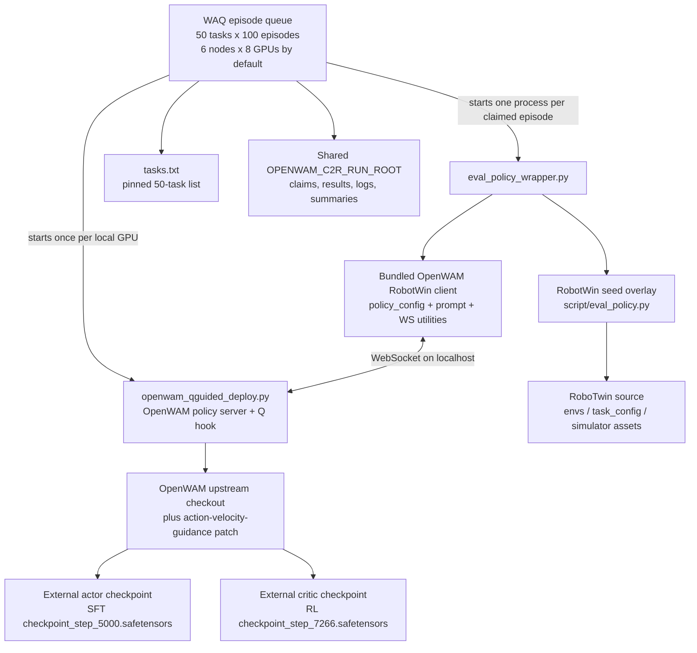

# OpenWAM RoboTwin clean-to-random evaluation

This folder packages the episode-queue runner and the small, experiment-specific evaluation adapters used for the 2026-10-12 OpenWAM clean-to-random evaluation. The runner has been made path-configurable and can start a fresh run without importing results from the original private run directory.

It is source-complete for the WAQ/OpenWAM evaluation glue, but it is not a self-contained model or simulator release. Reproduction still requires a compatible OpenWAM checkout, a RoboTwin installation with its task assets, and the matching actor and critic checkpoints described below.

## Dependency map



Runtime sequence, per node:

```mermaid
sequenceDiagram
    participant Queue as Episode queue
    participant Server as OpenWAM Q server (one per GPU)
    participant Wrapper as Eval wrapper (one process per episode)
    participant Sim as RoboTwin task environment
    participant Client as OpenWAM RobotWin client
    Queue->>Server: Start server; load actor + critic once
    Server-->>Queue: WebSocket ready
    loop Until each task reaches its target count
        Queue->>Wrapper: Claim task + candidate seed; run one episode
        Wrapper->>Sim: Initialize demo_randomized task with seed
        Sim->>Client: Observation, prompt, proprioception
        Client->>Server: WebSocket inference request
        Server->>Server: 10-step synchronous action denoising + Q guidance
        Server-->>Client: Action chunk
        Client-->>Sim: Execute action
        Wrapper-->>Queue: Success, actual seed, result file
    end
```

## Files in this folder

| File | Purpose | Provenance |
|---|---|---|
| `robotwin_qguided_episode_queue_official_20261012.py` | Distributed episode claims, per-GPU server startup, one-episode RoboTwin evaluation, retries and summaries. Defaults preserve the recorded 50-task / 100-episode protocol. | Adapted from the named server script; absolute personal paths were replaced with environment settings and a bundled task list. |
| `tasks.txt` | Sorted set of 50 RoboTwin task module names. | Captured from the evaluation's RoboTwin task modules; it avoids relying on the old, now-missing private `.../manifests/.../tasks` directory. |
| `openwam_qguided_deploy.py` | Loads the RL critic into the SFT actor's critic module and applies critic gradients to action denoising. | Evaluation-specific adapter. |
| `robotwin_source_overlay/script/eval_policy.py` | RoboTwin evaluator overlay that accepts the queue's per-episode seed start/stride and runs a single episode. | Derived from RoboTwin's MIT-licensed evaluation code; see `licenses/ROBOTWIN_LICENSE.txt`. |
| `eval_policy_wrapper.py` | Boots RoboTwin's evaluator in an isolated writable runtime directory and caps each invocation to one episode. | Copied from OpenWAM commit `3d5ba49fbe4db3f07c01726604011794ef499df8`; see `licenses/OPENWAM_LICENSE.txt`. |
| `policy_config.yml` | Client contract: `instruction_type: unseen`, 20D state, end-effector actions, localhost WebSocket. | Copied from the same OpenWAM commit. |
| `benchmarks/robotwin/` | OpenWAM RobotWin client, prompt formatting, and per-task step-limit overrides. | Copied from the same OpenWAM commit. |
| `benchmarks/utils/` | Shared WebSocket client, transport protocol, image payload handling, and action conversion. | Copied from the same OpenWAM commit. |
| `patches/openwam_action_velocity_guidance.patch` | Minimal changes to OpenWAM's server, inference engine, and architecture so the Q adapter can inject gradients into the actual action denoising loop. | Diff against the OpenWAM commit above. |

The patch adds the runtime hook in these upstream files:

- `openwam/deploy/server.py`
- `openwam/deploy/engine.py`
- `openwam/model/architectures/base.py`

The complete OpenWAM model/deployment package and RoboTwin simulator are intentionally not vendored. They are sizeable upstream projects with their own installation and asset requirements.

## Recorded evaluation protocol

- RoboTwin `demo_randomized` task configuration; `eval_video_log` is forced off for each episode.
- Client `instruction_type` is `unseen` from the bundled policy config.
- 50 tasks, 100 completed episode records (success or failure) per task; one queue worker per local GPU.
- Default topology: 6 nodes x 8 GPUs (48 workers). Each node runs local WebSocket servers on ports 18848–18855.
- Candidate seed streams start at 2,000,000 and are distributed by worker ID with a stride equal to the total worker count. RoboTwin may advance to a later seed if a scene is unstable; the actual evaluated seed is saved with each result.
- Each OpenWAM server uses 10 synchronous denoising steps, CFG 1.0, action chunk size 16, critic feature layer 0, guidance interval 5, total guidance budget 0.08, and the beta-envelope parameters `sigma_peak=0.25`, `concentration=8.0`. The guidance code selects eligible schedule indices and normalizes each critic gradient to unit norm before applying its allocated weight; the selected-step weights are not an equal split by assumption.
- The actor file is `checkpoint_step_5000.safetensors`; the paired critic file is `checkpoint_step_7266.safetensors`. Both were about 24.8 GB in the source environment. Neither model file is included in WAQ; the critic must contain `critic.*` tensors compatible with the actor architecture.

The queue starts from zero prior episodes when `OPENWAM_C2R_RUN_ROOT/queue/prior_counts.json` is absent. Use a new, empty run root for a clean reproduction. Importing episode counts from an earlier run is optional and only supported when its source directory is explicitly set with `OPENWAM_C2R_IMPORT_SOURCE_ROOT` and `--import-previous` is run once before workers start.

## External dependencies and environment

| Dependency | Required source / version | Notes |
|---|---|---|
| OpenWAM | [`OpenWAM-Official/OpenWAM`](https://github.com/OpenWAM-Official/OpenWAM), commit `3d5ba49fbe4db3f07c01726604011794ef499df8` | Check out this commit, then apply the included patch. It supplies the full model, config, schedulers, and server implementation used by the Q adapter. |
| RoboTwin | [`RoboTwin-Platform/RoboTwin`](https://github.com/RoboTwin-Platform/RoboTwin), commit expected by the OpenWAM wrapper: `0aeea2d669c0f8516f4d5785f0aa33ba812c14b4` | Install its simulator dependencies and task assets using the upstream instructions. The historical server checkout had no Git metadata and the evaluation skipped version checking, so that run's exact RoboTwin commit cannot be independently confirmed; pin and record this commit for a controlled rerun. |
| OpenWAM Python environment | Separate Python environment; source run used Python 3.12.14 and CUDA-enabled PyTorch 2.7.1+cu128 | Install from the pinned OpenWAM checkout and its official setup guide. |
| RoboTwin Python environment | Separate Python environment; source run used Python 3.10.20, PyTorch 2.4.1, SAPIEN 3.0.0b1, Warp 1.12.0 | Follow RoboTwin's setup guide. The wrapper prewarms CUDA/cuRobo best-effort before importing SAPIEN; simulator/system dependencies still need to be installed. |
| Actor and critic | User-provided external checkpoints listed above | Not included or hosted by this repository. Do not put multi-GB checkpoints in Git; publish them separately only if their license and access terms allow it. |
| Shared result storage | Shared absolute path visible to all worker nodes | Claims, episode JSON files, runtime configs, logs, and summaries are written here. |

The package versions above describe the source server at inspection time; they are not a complete lockfile. For a strict rerun, retain the environment lock/export and GPU driver/CUDA details alongside the released checkpoints.

## Setup and launch

1. Clone WAQ and install the two upstream projects as documented by their maintainers. Set `OPENWAM_REPO`, `ROBOTWIN_ROOT`, `OPENWAM_PYTHON`, and `ROBOTWIN_PYTHON` to their local paths.
2. In the OpenWAM checkout, select the pinned commit and apply this repository's patch:

   ```bash
   git -C "$OPENWAM_REPO" checkout 3d5ba49fbe4db3f07c01726604011794ef499df8
   git -C "$OPENWAM_REPO" apply /path/to/WAQ/evaluation/openWAM_c2r/patches/openwam_action_velocity_guidance.patch
   ```

3. Copy `run.env.example` to `run.env` (ignored by Git), then set the actual actor, critic, and shared-storage paths. The same `OPENWAM_C2R_RUN_ROOT` must be an absolute shared path on every node.
4. On each of the six nodes, source the same configuration and start its worker with a unique node index:

   ```bash
   source /path/to/run.env
   python "$WAQ_ROOT/evaluation/openWAM_c2r/robotwin_qguided_episode_queue_official_20261012.py" --node-index 0
   ```

   Use `--node-index 1` through `5` on the other nodes. Each worker uses local GPUs `0`–`7`. Set `OPENWAM_C2R_NODE_COUNT` and `OPENWAM_C2R_GPUS_PER_NODE` consistently on all nodes if using different hardware.

For a strict experiment reproduction, use the same actor/critic files, task assets, task configuration, GPU software stack, and worker topology. The asynchronous queue preserves the protocol and seed stream but does not promise bit-for-bit deterministic episode ordering across hardware or scheduling changes.

## License and redistribution notes

OpenWAM-derived files and the guidance patch are covered by the included Apache-2.0 notice; the RoboTwin-derived evaluator overlay is covered by the included MIT notice. The simulator assets and actor/critic checkpoints have separate upstream or experiment-specific distribution terms and are not included.
